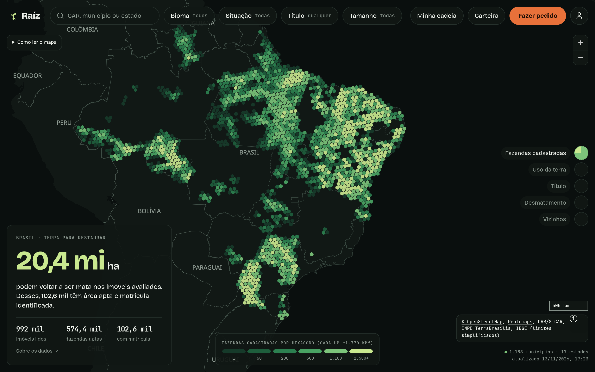
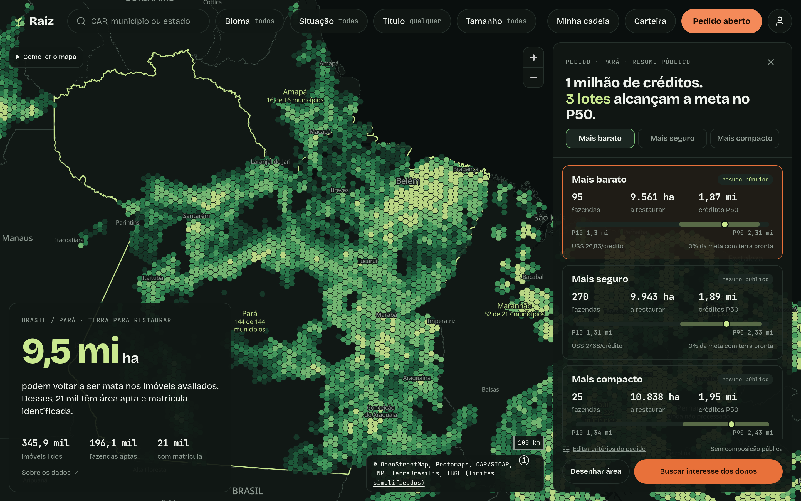
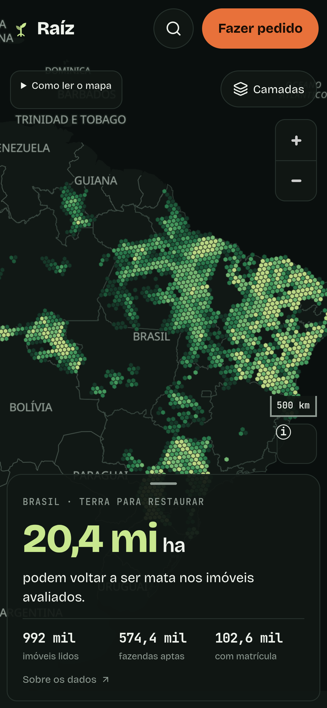

# Comparação visual V2 com dados públicos

As três telas foram capturadas com Playwright e comparadas aos arquivos
`print_brasil.png`, `print_pedido.png` e `print_celular.png` do pacote aprovado
`raiz-visual-v2-telas.zip`. O resultado mantém mapa inteiro, base escura, hexágonos,
fontes Bricolage Grotesque/JetBrains Mono e painéis flutuantes. As diferenças de dados,
acesso público e cartografia estão registradas abaixo; não se declara igualdade de pixels.

O [relatório de capturas](relatorio-capturas.json) registra **151 respostas HTTP,
zero 404, zero erro HTTP, zero erro JavaScript, zero erro de console e zero requisição
falha** nessa navegação. As três telas não tiveram rolagem horizontal. A medição de
Lighthouse consta em seção separada: cenário local do CI aprovado; retrato completo
ainda abaixo da meta. O CI da revisão final permanece pendente.

## Arquivos, dimensões e origem

| Tela | Antes publicado | V2 | Viewport da V2 / DPR |
|---|---|---|---|
| Brasil | [antes-brasil.png](antes-brasil.png), 1440 × 1000, DPR 1 | [depois-brasil.png](depois-brasil.png) | 1440 × 900 / 2 |
| Pedido | Não havia painel equivalente nesta captura | [depois-pedido.png](depois-pedido.png) | 1440 × 900 / 2 |
| Celular | [antes-celular.png](antes-celular.png), 360 × 800, DPR 1 | [depois-celular.png](depois-celular.png) | 390 × 844 / 3 |

As imagens V2 têm as mesmas dimensões e DPR dos três prints aprovados: 2880 × 1800
nos dois casos desktop e 1170 × 2532 no celular. Os registros anteriores têm outras
dimensões; a comparação entre antes e depois é de composição e comportamento.

Os cinco PNGs foram copiados sem edição, redimensionamento ou recompressão. Somam
3,90 MB, com SHA-256 e tamanho individual no relatório. Isso preserva os números e
rótulos pequenos. As respostas de rede foram publicadas apenas com caminho e status;
a origem localhost e o caminho temporário de trabalho foram retirados do relatório.

- **Antes:** publicação do [PR #90](https://github.com/bernardoemmel/Raiz/pull/90),
  main `c9d6302646f40e7d6a3eb3a1d3a0c4d669301aab`, capturada em 13/11/2026 às
  19:18 de Brasília no site público.
- **Depois:** build local `site-v2-13`, capturado em 13/11/2026 entre 21:09:32 e
  21:09:41 de Brasília, Chrome for Testing 158.0.8127.18, contexto anônimo e movimento
  reduzido. O servidor de validação responde HTTP Range para os PMTiles.
- **Dados:** artefato público auditado da publicação anterior, 4.511 arquivos,
  SHA-256 `5590d75b8de2c10cd7e2bc2f49ce638822ed9b7982c2441eac7abca16101a92a`.
  A V2 usa esse retrato fixo para permitir conferência; a captura não afirma ser o
  retrato mais recente que o processamento possa ter publicado depois.

## Comparação com cada print aprovado

| Referência | O que corresponde | Diferenças visíveis e motivo |
|---|---|---|
| `print_brasil` | Mapa sem coluna lateral; base escura; topo em pílulas; H3 r4 em seis tons; cartão de 400 px com número lima; legenda e camadas flutuantes. | Protomaps substitui o Carto de teste, conforme o guia, por isso rótulos e limites diferem. A camada diz **Fazendas cadastradas** e o filtro começa em **todas**: o agregado não contém apenas aptas. O cartão mostra valores reais com uma casa decimal, descrição de matrícula e acesso a **Sobre os dados**; é mais alto que o da maquete. Controles de zoom, ajuda e atribuição permanecem acessíveis. |
| `print_pedido` | Painel à direita, 430 px, três opções, seleção urucum, números mono e faixa P10/P50/P90 em escala comum. | O título informa que os três lotes alcançam a meta **no P50**, sem afirmar garantia no P10. O painel público acrescenta preço médio e terra pronta; mantém rolagem para informações adicionais. Não pinta os 22 hexágonos escolhidos ilustrativamente na maquete nem mostra composição. O cartão territorial acompanha o Pará e continua no desktop. A reserva não informada não recebe os 20% ilustrativos. |
| `print_celular` | Viewport 390 × 844, mapa inteiro com H3, marca/busca/pedido no topo e cartão inferior com número de 48 px. | Busca e conta abrem diálogos/menu acessíveis; alça, ajuda, Camadas e zoom permanecem disponíveis. O cartão mostra **com matrícula** e o link **Sobre os dados**; a frase complementar aparece ao expandir. Os alvos de toque do topo são de 48 px. A gaveta mantém o recuo de 8 px da referência. Os créditos começam recolhidos em botão de informação e abrem por toque ou teclado. |

Essas comparações registram o estado efetivamente capturado. O cartão e o pedido
não copiam os números da maquete; arredondamento e texto refletem o contrato disponível.
As fontes são locais, apenas woff2 latino, com licenças SIL OFL no produto. O tema
claro do produtor não foi alterado.

## Números e datas conferidos no retrato

O cartão nacional soma os resumos de aptidão de **724 municípios em 13 estados**:
20.357.288 ha, 992.019 imóveis lidos, 574.373 aptas e 102.621 com matrícula identificada.
O manifesto desses dados foi publicado em 13/11/2026 às 17:05:30 de Brasília.

A cobertura dos desenhos básicos é outra medida: **1.188 municípios em 17 estados**,
com manifesto de 13/11/2026 às 17:23:26 de Brasília. O H3 contém 8.871 células r5,
2.331.082 cadastros e 4.142 células sem medida suficiente de hectares, gerado às
17:31:34 de Brasília. A escala permanece na contagem de cadastros; valores ausentes
não viram zero e hectares do resumo não são atribuídos artificialmente aos hexágonos.

O pedido usa `amostra/lote_PA_central_r11.json`, contrato `publico_lotes`, cenário
`central_r11`, modelo `restauracao-2026d+a84f9789`, atualizado em 12/11/2026 às 17:47:42
de Brasília. A meta publicada é 1 milhão de créditos. Os três lotes são alternativas;
não devem ser somados nem tratados como um pedido recalculado pelos filtros da tela.

| Opção | Fazendas | Hectares | P10 | P50 | P90 | US$/crédito |
|---|---:|---:|---:|---:|---:|---:|
| Mais barato | 95 | 9.561,3 | 1.298.148 | 1.871.150 | 2.309.231 | 26,83 |
| Mais seguro | 270 | 9.942,8 | 1.310.708 | 1.891.833 | 2.332.670 | 27,68 |
| Mais compacto | 25 | 10.838,4 | 1.339.520 | 1.950.679 | 2.426.929 | 33,29 |

A fração da meta com terra pronta é zero nas três opções desse arquivo. Reserva
percentual não foi informada. A captura não acessa a API paga, não identifica os
imóveis que compõem os lotes e não exibe nome, CPF ou contato de proprietário.
Nenhum clique de envio de contato foi realizado.

## Telas capturadas

### Brasil

[Ver a tela nacional anterior](antes-brasil.png).

### Pedido público

### Celular

[Ver a tela de celular anterior](antes-celular.png).

## Medição: fixture do CI e retrato completo

O [registro das séries Lighthouse](lighthouse-series.json) preserva as **24 amostras
das oito versões do retrato público completo**, inclusive as reprovadas. Na versão
mais recente, `site-v2-13`, o desempenho foi **84 / 86 / 81**, com mediana **84**, e a
acessibilidade foi **100 nas três amostras**. A meta de desempenho ≥ 90 com o retrato
completo **continua pendente**.

Separadamente, o comando completo `node front/scripts/testar-acessibilidade.mjs`
passou localmente em 14/11/2026, entre 00:09 e 00:12 UTC, com a **fixture pública e
sintética configurada para o CI**. As 18 amostras também estão no JSON, em um campo
separado. Isso comprova a execução local desse portão; não afirma que o GitHub Actions
já passou nem transfere a aprovação para os dados completos.

| Página da fixture | Desempenho, mediana de três | Acessibilidade mínima |
|---|---:|---:|
| Brasil | 94 | 100 |
| Entrar | 96 | 100 |
| Novo pedido | 95 | 100 |
| Prospecção | 95 | 100 |
| Acerto do modelo | 96 | 100 |
| Produtor | 100 | 100 |

O mesmo comando aprovou teclado, largura de 360 px e axe WCAG 2.1 AA. As medições
recentes usam Chromium **158.0.8127.18**, fixado pelo Playwright do CI, viewport
360 × 800, DPR 1, CPU/rede simuladas e SwiftShader. As séries anteriores identificam
separadamente o Chromium 157 usado; diagnósticos instrumentados não entram nas notas.

Os traces também identificaram descarte nativo do compositor por volta de um segundo
após navegar. O código da versão exata do Chromium agenda essa
[liberação após 1.000 ms](https://chromium.googlesource.com/chromium/src/+/158.0.8127.18/third_party/blink/common/features.cc#585)
e [espera sincronamente a fila gráfica](https://chromium.googlesource.com/chromium/src/+/158.0.8127.18/cc/trees/proxy_main.cc#923).
O evento foi observado também sem Lighthouse e sem screenshots. Esse diagnóstico
explica uma parcela do custo; não altera o portão nem comprova desempenho aprovado.

## Limites desta evidência

O relatório comprova a navegação e os arquivos efetivamente capturados. Não substitui
os testes de autorização, a auditoria completa da publicação, o teste de teclado/axe,
a medição Lighthouse ou o CI. **O cenário controlado passou localmente; a meta de
desempenho com o retrato completo e o CI da revisão final permanecem pendentes.**
