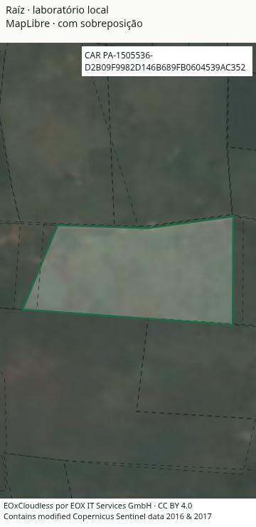
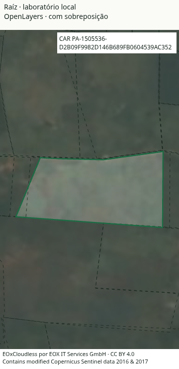
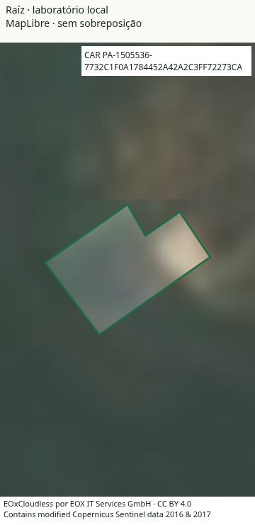
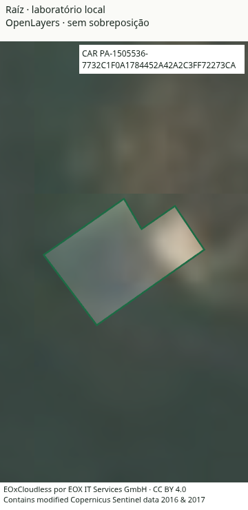

# Comparação OpenLayers e MapLibre, rodada 12

**Manter MapLibre. Esta série é exploratória e tem uma falha de baseline.** A candidata OpenLayers 10.11.0, com renderizador Canvas, abriu mais rápido nos dois imóveis, mas piorou os movimentos e a seleção no imóvel com sobreposição. A revisão posterior encontrou que o laboratório não carregou o plugin do Vite que remove o desenho do céu transparente no MapLibre do produto. Portanto, estes números não são uma comparação exata contra o mapa otimizado atual e não autorizam uma troca.

Esta é uma comparação isolada de renderizadores. Não é Lighthouse, não demonstra equivalência à aplicação completa e não altera os gates do site. Nenhuma dependência do produto foi trocada.

## Resultado

Chrome for Testing **157.0.8103.78**, viewport de **360 × 740 px**, mapa de **360 × 640 px**, DPR 1, CPU 4×, rede de 1,6 Mbit/s e latência de 150 ms. Um navegador novo por observação, cache HTTP desabilitado e nenhuma execução concorrente de navegador ou build. A ordem foi **MapLibre, OL, OL, MapLibre, MapLibre, OL, OL, MapLibre** em cada imóvel: 16 observações, sem descarte ou repetição da série.

Os números abaixo são medianas das quatro observações de cada motor. Nos percentis, calcula-se primeiro o p95 de cada observação e depois a mediana dos quatro p95.

| Imóvel e medida | MapLibre 6.15.0 | OpenLayers 10.11.0 Canvas | Critério |
| --- | ---: | ---: | --- |
| Com sobreposição: abertura completa | 4.079,6 ms | 2.460,6 ms | OL melhora 39,7%, passa |
| Com sobreposição: intervalo de render, p95 | 31,02 ms | 85,05 ms | OL reprova |
| Com sobreposição: intervalos acima de 33,3 ms | 3,67% | 82,47% | OL reprova |
| Com sobreposição: seleção, p95 | 35,17 ms | 61,01 ms | OL reprova |
| Sem sobreposição: abertura completa | 4.116,5 ms | 2.375,3 ms | OL melhora 42,3%, passa |
| Sem sobreposição: intervalo de render, p95 | 26,75 ms | 20,07 ms | OL passa |
| Sem sobreposição: intervalos acima de 33,3 ms | 1,69% | 0,57% | OL passa |
| Sem sobreposição: seleção, p95 | 38,37 ms | 34,36 ms | OL passa |

OL venceu a abertura nos quatro pares de cada imóvel. A regra de interação permitia no máximo o maior entre 10% e 4 ms de regressão nos p95 e até 2 pontos percentuais a mais de intervalos acima de 33,3 ms. O caso sobreposto excedeu os três limites.

[Resultado e decisões](resultado-exploratorio.json), [todas as 16 observações](amostras-exploratorias.csv), [plano registrado](plano-exploratorio.md) e [manifesto congelado antes da série](manifesto-exploratorio.json).

## O que foi comparado

Os dois motores receberam **a mesma coleção completa de 2.194 CARs**, ordenada por área para desenhar os maiores embaixo. Somente código do CAR, indicador topológico e geometria pública; nenhum dado de dono ou composição de lote. Os imóveis foram escolhidos antes de medir pela complexidade mediana entre geometrias válidas com dimensão compatível com o enquadramento. As interseções foram conferidas independentemente com Shapely:

- Com sobreposição: `PA-1505536-D2B09F9982D146B689FB0604539AC352`, três interseções positivas com vizinhos.
- Sem sobreposição: `PA-1505536-7732C1F0A1784452A42A2C3FF72273CA`, nenhuma interseção positiva na coleção municipal.

A projeção EPSG:3857, resolução em metros por pixel, câmera, satélite, véu, contorno de 1 px, tracejado, destaque e máscara foram compartilhados. O MapLibre preservou o aquecimento da GPU, `desynchronized`, `feature-state` e a validação prévia do estilo. **Faltou o plugin `maplibreCeuTransparente()` do build do produto**: ele não modifica persistentemente `node_modules`, como foi assumido na preparação. O Vite isolado importou o módulo original. A alegação de patch preservado no plano prévio estava errada e fica preservada como parte do registro, com esta correção explícita. O preparo específico dos programas nacionais não se aplica ao estilo destes imóveis.

Cada observação inclui três sequências de 60 atualizações de pan, 60 de zoom e 20 seleções/limpezas. Os 354 comandos de câmera com mudança efetiva foram confirmados em cada observação; os seis comandos iniciais sem mudança ficaram identificados. O primeiro pan/zoom pode buscar tiles recém-visíveis, e esse custo permaneceu nos resultados. Os cancelamentos esperados desses tiles foram registrados separadamente.

Foram **zero respostas HTTP ≥ 400, zero erros JavaScript e zero erros de fonte nos 16 casos**. Houve quatro `net::ERR_ABORTED` do MapLibre, um em cada observação do imóvel sobreposto, somente para tiles locais existentes que saíram da vista. O coletor exige essas condições para classificá-los como cancelamentos de câmera; outros erros de requisição reprovam.

O laboratório compartilha página e dados e separa importação, término dos dados comuns e construção/desenho. Por exemplo, no caso sobreposto, a mediana do import foi 2.814,7 ms no MapLibre e 1.165,8 ms no OL. A mediana após módulo e dados estarem disponíveis foi 1.264,8 ms e 607,1 ms. Essas etapas incluem operações assíncronas e rede; não são uma medição pura de GPU. O ganho do laboratório não foi atribuído à remoção de React, painéis ou outras funções da aplicação.

## Conferência visual e limites

Os oito ensaios funcionais anteriores à série cobriram os dois imóveis, dois motores e larguras de 360 e 960 px. Projeção, seleção no interior e na interseção, ponto exterior, máscara, hover e Enter/Escape passaram. O maior erro entre os cinco pontos de controle dos motores foi inferior a 4 × 10⁻⁹ px.

O MapLibre escala o tracejado pela fração do zoom devido ao uso de `tileZoom` inteiro na textura. O adaptador OL reproduz esse período físico. A análise de um segmento real encontrou períodos de 10,44/10,69 px a 360 px e 8,27/8,27 px a 960 px, respectivamente. Persistem diferenças de antialias e quantização, descritas em [paridade-tracejado.json](paridade-tracejado.json); não se afirma igualdade de pixels.

| | MapLibre | OpenLayers Canvas |
| --- | --- | --- |
| Com sobreposição |  |  |
| Sem sobreposição |  |  |

As capturas são do ensaio funcional final, com os mesmos bundles congelados usados na série. A sequência de câmera foi automatizada por API; não se mediu a latência completa de gestos físicos do sistema operacional.

- `render completo + próximo RAF` é um **proxy de oportunidade de apresentação**. Não garante que o compositor/GPU já mostrou esses pixels na tela. A seleção aguarda também a atualização da fonte da máscara.
- SwiftShader e CPU simulada não representam todas as GPUs ou celulares. O resultado se limita a esta candidata Canvas e a este protocolo, não a todos os renderizadores ou configurações possíveis do OpenLayers.
- O satélite comum ficou sem a dessaturação e o contraste particulares do produto. O acabamento completo e a paridade nacional de fundo, estados, rótulos e grupos seriam obrigatórios antes de qualquer troca.
- A prova nacional não foi executada. A candidata reprovou um caso neste laboratório, mas o baseline incompleto impede tratar a série como a comparação exata exigida contra o produto. Nenhuma vitória em produção foi declarada.
- `JSHeapUsedSize` aparece somente como diagnóstico da thread principal. Exclui workers e GPU e varia com coleta de lixo; não é memória total nem critério de vitória.
- As tentativas anteriores de ensaio revelaram problemas no próprio coletor e foram preservadas localmente em `functional*`. Elas não são observações da série medida.

## Dados e reprodução

Este é o registro da série original, anterior à correção. A [série corrigida e a decisão atual](README.md) estão separadas.

O snapshot é o build público congelado em `/tmp/raiz-fontes-final-real-site`, derivado do commit [`7fe3539`](https://github.com/bernardoemmel/Raiz/commit/7fe3539f63416258f0d91e1c4371fc4d52899aa6), com índice cartográfico de 12/11/2026 às 23:54:43 UTC. A fonte municipal é `geo/imoveis_1505536.geojson.gz`.

[Release público](https://github.com/bernardoemmel/Raiz/releases/tag/dados), [arquivo público atual](https://bernardoemmel.github.io/Raiz/geo/imoveis_1505536.geojson.gz) e [proveniência completa, hashes e tiles](proveniencia-dados.json). **A URL pública é mutável.** Na conferência de 13/11/2026, respondeu 200 e tinha exatamente os mesmos CARs e geometrias, mas ainda sem o indicador `sobreposto` presente no snapshot. Não é substituto silencioso para o arquivo congelado. Reproduzir exige a entrada com o hash registrado, inclusive quando a publicação atual já tiver mudado.

[criar-laboratorio.py](criar-laboratorio.py) copia os scripts para um diretório novo e adapta somente os caminhos locais. Exige checkout isolado e limpo do commit registrado, snapshot correto e Chrome 157. A opção `--serie exploratoria` conserva inclusive a ausência do plugin encontrada nesta série; um protocolo corrigido precisa ser identificado separadamente. As dependências do front desse checkout devem estar instaladas, assim como Python com Shapely, Pillow e NumPy. Nenhum vendor bundle ou conjunto de geometrias entrou nesta pasta.

```bash
python criar-laboratorio.py --serie exploratoria --repo /caminho/raiz-7fe3539 --snapshot /caminho/site-congelado --chrome /caminho/chrome157 --destino /tmp/raiz-comparacao-repro
```

As instruções geradas no destino instalam apenas o `ol` fixado no lockfile do laboratório, conferem a geometria e cada tile contra os hashes registrados, validam o estilo, constroem os dois adaptadores, iniciam o servidor e executam ensaio funcional seguido da série fixa. Uma nova execução é uma nova série e deve ter seus resultados identificados; não substitui as 16 observações registradas aqui.

Os eventos detalhados originais totalizam 6,6 MB e permanecem em `/tmp/raiz-comparacao-openlayers/serie`. [Hashes de cada relatório original](relatorios-exploratorios.json) permitem conferir a integridade. Esta pasta conserva todas as observações resumidas, os scripts e quatro capturas, sem copiar bundles ou dados grandes.

## Licenças

OpenLayers 10.11.0: BSD-2-Clause. MapLibre 6.15.0: BSD-3-Clause. As 23 dependências locais do OL foram conferidas; têm BSD, MIT, ISC, Apache-2.0, Zlib ou CC0. Lerc declara Apache-2.0 no cabeçalho do código e no README; os leitores GeoTIFF/Lerc não entram no bundle vetorial usado aqui. [Inventário de versões e textos de licença](licencas.json) e [avisos do laboratório](NOTICE.md).

O mosaico é **EOxCloudless 2016/2017**, camada legada `s2cloudless_3857`, CC BY 4.0, de uso comercial. Mantém o crédito EOX e Copernicus. A conferência de licença do ano foi registrada no produto em 12/11/2026; os anos posteriores com licença NC não foram usados. Os mesmos 41 tiles foram congelados localmente com origem e hash, e somente os tiles necessários à vista foram requisitados por cada motor.
