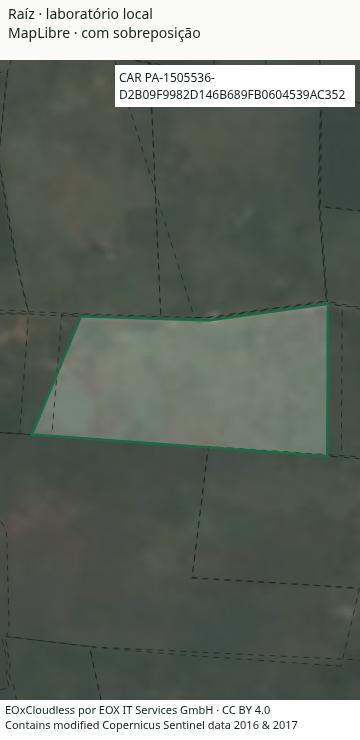
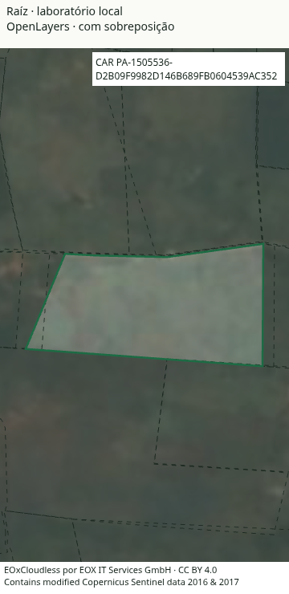
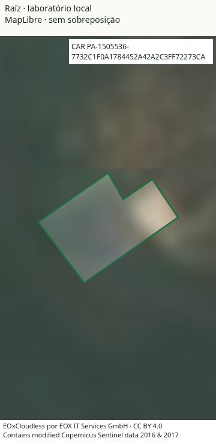
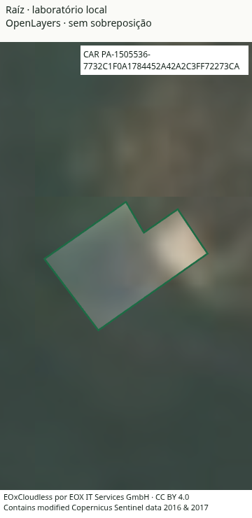

# MapLibre mantido após a comparação

**A candidata OpenLayers 10.11.0 Canvas não passou no critério combinado dos dois imóveis.** Na série corrigida, abriu mais rápido, mas piorou os movimentos e a seleção do imóvel sobreposto. O produto conserva MapLibre. Não houve troca de dependência nem mudança dos portões de Lighthouse.

Este é um laboratório de renderização, com os mesmos dados e interface para ambos os motores. Não é uma medição da aplicação completa. A série inicial tinha uma falha de baseline e permanece separada como [exploratória](README-exploratoria.md); ela não foi substituída nem apresentada como equivalente ao produto.

## Série corrigida

Chrome for Testing **157.0.8103.78**, viewport de **360 × 740 px**, mapa de **360 × 640 px**, DPR 1, CPU 4×, rede de 1,6 Mbit/s e latência de 150 ms. Cada observação usa um navegador novo, cache HTTP desabilitado e nenhum navegador ou build concorrente.

A ordem fixada antes da medição foi **MapLibre, OL, OL, MapLibre, MapLibre, OL, OL, MapLibre** para cada imóvel. Todas as 16 observações foram mantidas. Os valores abaixo são medianas das quatro observações de cada motor. Para p95, calcula-se o percentil em cada observação e depois a mediana desses quatro percentis.

| Imóvel e medida | MapLibre 6.15.0 | OpenLayers 10.11.0 Canvas | Resultado da candidata |
| --- | ---: | ---: | --- |
| Com sobreposição: abertura completa | 4.098,25 ms | 2.406,50 ms | Melhora 41,28%; passa |
| Com sobreposição: intervalo de render, p95 | 20,12 ms | 82,08 ms | Reprova |
| Com sobreposição: intervalos acima de 33,3 ms | 0,28% | 82,04% | Reprova |
| Com sobreposição: seleção, p95 | 34,81 ms | 58,98 ms | Reprova |
| Sem sobreposição: abertura completa | 4.144,75 ms | 2.377,70 ms | Melhora 42,63%; passa |
| Sem sobreposição: intervalo de render, p95 | 20,50 ms | 20,81 ms | Passa |
| Sem sobreposição: intervalos acima de 33,3 ms | 0,42% | 1,01% | Passa |
| Sem sobreposição: seleção, p95 | 36,33 ms | 34,67 ms | Passa |

OL venceu a abertura nos quatro pares de cada imóvel. O plano exigia ganho de pelo menos 20% e vitória em pelo menos três pares **em cada imóvel**, sem piorar p95 de render/seleção além do maior entre 10% e 4 ms, nem aumentar os intervalos lentos em mais de dois pontos percentuais. O caso sobreposto excedeu os três limites de interação. Uma vitória na abertura não satisfaz esse conjunto de critérios.

[Resultado e decisões](resultado.json) · [Todas as 16 observações corrigidas](amostras.csv) · [Plano registrado](plano-registrado.md) · [Manifesto congelado](manifesto-congelado.json) · [Verificação independente da integridade](integridade-serie.json).

A prova nacional adicional não foi executada, pois a candidata já reprovou no portão dos imóveis. O campo `production` do relatório bruto registra a ausência de paridade nacional; não significa que a candidata passou no critério anterior nem autoriza uma troca.

## Baseline e interrupção

A revisão da primeira série encontrou que seu Vite isolado não carregava `maplibreCeuTransparente()`. O plugin do produto não altera persistentemente `node_modules`. Essa falha foi corrigida **antes** da nova série, mantendo os mesmos dados, ordem e critérios. A série original conserva [suas 16 observações](amostras-exploratorias.csv), [resultado](resultado-exploratorio.json), [manifesto](manifesto-exploratorio.json) e [hashes dos relatórios](relatorios-exploratorios.json).

Na série corrigida, o Vite importa o plugin original do checkout. A [prova de baseline](baseline-verificado.json) confere a versão 6.15.0, o hash do módulo original, a saída exata do plugin no sourcemap, a guarda de transparência no bundle e a fonte do shader. Os bundles de OL, preparação GPU e worker MapLibre ficaram byte a byte iguais aos da primeira série. O aquecimento da GPU, `desynchronized`, `feature-state` e a validação prévia do estilo continuam presentes. A preparação exclusiva de programas nacionais não se aplica ao estilo dos imóveis deste laboratório.

O ambiente de execução reiniciou às **19:24 UTC de 13/11/2026**, depois de 12 observações completas: as oito do imóvel sobreposto e as quatro primeiras do outro imóvel. Os processos desapareceram. Uma eventual tentativa seguinte foi interrompida sem resultado; não há métricas parciais dela e nenhuma conclusão foi atribuída a essa tentativa.

A retomada verificou os **69 arquivos do manifesto**, a versão do Chrome e os hashes dos 12 resultados, sem reconstruir bundles. Um [runner separado](runner-retomada.mjs) executou somente as quatro posições restantes e recusava sobrescrever resultados existentes. As 12 observações anteriores permaneceram byte a byte intactas. [Registro da interrupção](interrupcao-retomada.json) e [hashes anteriores à retomada](retomada-preexistentes.json).

Não foi comprovado que CPU e cache gráfico do host ficaram idênticos após o reinício. Portanto, o imóvel sem sobreposição combina duas sessões do ambiente, com duas observações de cada motor antes e depois. **O caso sobreposto que reprovou foi medido integralmente antes do reinício.** Nenhuma observação completa foi descartada, escolhida ou repetida.

## Dados, interação e paridade

Ambos os motores receberam **a mesma coleção municipal completa de 2.194 CARs**, ordenada por área para desenhar os maiores embaixo. São geometrias e códigos públicos, com indicador topológico; não há nome, CPF, contato ou composição de lote. Os imóveis foram escolhidos antes de medir pela complexidade mediana entre geometrias válidas e de dimensão compatível com o enquadramento. Interseções positivas foram conferidas com Shapely:

- Com sobreposição: `PA-1505536-D2B09F9982D146B689FB0604539AC352`, três interseções com vizinhos.
- Sem sobreposição: `PA-1505536-7732C1F0A1784452A42A2C3FF72273CA`, nenhuma interseção na coleção municipal.

Projeção EPSG:3857, resolução em metros por pixel, câmera, satélite, véu, contorno de 1 px, tracejado, hover e máscara foram compartilhados. Cada observação inclui três sequências de 60 atualizações de pan, 60 de zoom e 20 seleções/limpezas. Os **354 comandos de câmera com mudança efetiva foram confirmados em cada observação**; seis comandos iniciais sem mudança ficaram identificados. O primeiro pan/zoom pode carregar tiles recém-visíveis, e esse custo permaneceu nas medidas.

A validação externa recusaria identidades duplicadas/ausentes, métricas não finitas, comandos não confirmados ou erros finais. Passaram as 16 observações: **zero HTTP ≥ 400, zero erros JavaScript e zero erros de fonte**. Quatro cancelamentos `net::ERR_ABORTED` do MapLibre, um por observação sobreposta, foram classificados separadamente: tiles locais existentes saíram da vista. Outros erros de requisição reprovariam o coletor.

Oito ensaios funcionais corrigidos cobriram os dois imóveis, os dois motores e larguras de 360 e 960 px. Projeção, seleção no interior/interseção, ponto exterior, máscara, hover e Enter/Escape passaram. O erro máximo entre os cinco pontos de controle foi inferior a 4 × 10⁻⁹ px. Os quatro prints abaixo são da configuração corrigida; comparados aos mesmos prints da configuração exploratória, são pixel a pixel idênticos, como esperado da remoção de um desenho transparente. [Prova de paridade corrigida](paridade-corrigida.json).

O MapLibre escala o tracejado pela fração do zoom por causa de `tileZoom` inteiro. O adaptador OL reproduz esse período físico. A análise de um segmento encontrou 10,44/10,69 px a 360 px e 8,27/8,27 px a 960 px, respectivamente. Persistem diferenças de antialias e quantização entre motores; não se afirma igualdade de pixels entre MapLibre e OL. [Conferência do tracejado](paridade-tracejado.json).

| | MapLibre | OpenLayers Canvas |
| --- | --- | --- |
| Com sobreposição |  |  |
| Sem sobreposição |  |  |

## Limites

- `render completo + próximo RAF` é um **proxy de oportunidade de apresentação**, não uma prova de pintura física pelo compositor/GPU. A seleção também aguarda a atualização da fonte da máscara. A câmera foi automatizada por API, sem medir gestos físicos do sistema operacional.
- SwiftShader, CPU simulada, quatro observações por motor/caso e os dois imóveis não representam todos os celulares ou configurações do OpenLayers. A decisão vale para esta candidata Canvas e este protocolo.
- O satélite comum não inclui a dessaturação e o contraste particulares do produto. Acabamento completo e cena nacional equivalente seriam necessários antes de qualquer troca.
- O laboratório compartilha página/dados e separa importação, término dos dados comuns e construção/desenho. Essas etapas incluem rede e operações assíncronas; não são tempo puro de GPU nem ganho atribuído à remoção de React/painéis.
- `JSHeapUsedSize` é diagnóstico da thread principal, sem workers/GPU. Não é memória total nem critério de vitória.
- As tentativas de ensaio que corrigiram o próprio coletor permanecem localmente em `functional*`; não são observações da série medida. As duas séries e a interrupção são identificadas separadamente.

## Origem e reprodução

Snapshot público congelado em `/tmp/raiz-fontes-final-real-site`, derivado do commit [`7fe3539`](https://github.com/bernardoemmel/Raiz/commit/7fe3539f63416258f0d91e1c4371fc4d52899aa6), com índice de 12/11/2026 às 23:54:43 UTC. Fonte: `geo/imoveis_1505536.geojson.gz`. [Proveniência, hashes e tiles](proveniencia-dados.json).

O [Release público](https://github.com/bernardoemmel/Raiz/releases/tag/dados) e o [arquivo atual do site](https://bernardoemmel.github.io/Raiz/geo/imoveis_1505536.geojson.gz) são mutáveis. Na conferência de 13/11/2026, o arquivo atual tinha os mesmos CARs/geometrias, mas ainda não o indicador `sobreposto` do snapshot. Não o substitua silenciosamente: a reprodução exige o hash congelado. Geometrias e tiles não foram copiados para o git.

[criar-laboratorio.py](criar-laboratorio.py) materializa os scripts em diretório novo, exige checkout limpo no commit registrado, snapshot correto e Chrome 157. O padrão é a série **corrigida**, com o plugin original e conferência do bundle. Os scripts exportados adaptam caminhos locais; o verificador compara auxiliares com hashes registrados, não com o próprio build. Os manifestos medidos permanecem intactos.

```bash
python criar-laboratorio.py --serie corrigida --repo /caminho/raiz-7fe3539 --snapshot /caminho/site-congelado --chrome /caminho/chrome157 --destino /tmp/comparacao-nova
```

O checkout deve ter suas dependências travadas instaladas, Node 24.22.1 e Python com Shapely/Pillow/NumPy. As instruções geradas instalam somente o `ol` fixado no lockfile do laboratório, conferem dados/tiles, validam o estilo e o plugin, constroem os adaptadores e orientam ensaio funcional antes da série fixa. Para reproduzir a configuração antiga sem plugin, use `--serie exploratoria`. Toda nova execução é outra série; não substitui nenhuma observação registrada.

Os eventos detalhados das duas séries totalizam cerca de 13,2 MB e permanecem nos dois laboratórios locais. [Hashes dos 16 relatórios corrigidos](relatorios-originais.json) e [dos 16 exploratórios](relatorios-exploratorios.json) permitem conferir sua integridade. Esta pasta conserva todas as observações resumidas, os scripts e quatro capturas, sem bundles de fornecedor nem dados grandes.

## Licenças

OpenLayers 10.11.0: BSD-2-Clause. MapLibre 6.15.0: BSD-3-Clause. As 23 dependências locais do OL têm licenças BSD, MIT, ISC, Apache-2.0, Zlib ou CC0. Lerc declara Apache-2.0 no cabeçalho e README; leitores GeoTIFF/Lerc não entram no bundle vetorial usado. [Inventário](licencas.json) e [avisos/textos de licença](NOTICE.md).

O mosaico é **EOxCloudless 2016/2017**, camada legada `s2cloudless_3857`, CC BY 4.0, com uso comercial e crédito EOX/Copernicus. A licença do ano está registrada no produto; não foram usadas edições posteriores NC. Os mesmos 41 tiles foram congelados com origem/hash, e cada motor requisitou somente os necessários à vista.
